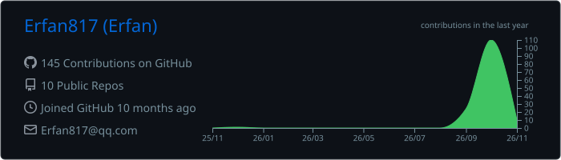
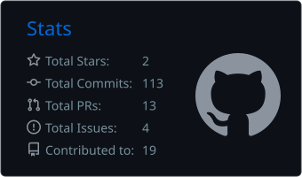
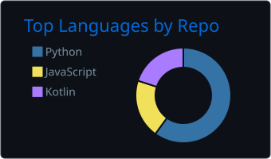
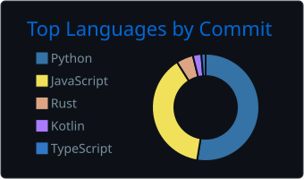

# 你好，我是 Erfan 👋

> CS 在读 · AI Agent 方向 · Coding Agent 重度用户

- 🎓 计算机科学与技术 · 2029 届
- 🔭 当前在做：个人 Agent / Coding Agent 应用开发
- 🌱 技术栈：Java · Python · Rust（入门中）
- 📝 博客：[Erfanblog.top](https://erfanblog.top)

## 🔥 Contributed to

- [Hy4ri/hermes-mobile](https://github.com/Hy4ri/hermes-mobile)  (Kotlin) —— Hermes Agent 的原生 Android 客户端
  - PR [#1751](https://github.com/Hy4ri/hermes-mobile/pull/1751)：fix(#1750) 避免定时任务步骤间隔描述误导
- [akitaonrails/ai-memory](https://github.com/akitaonrails/ai-memory)  (Rust) —— 给 Coding CLI 提供长期记忆的开源项目
  - PR [#1337](https://github.com/akitaonrails/ai-memory/pull/1337)：first-party DeepSeek Harness (DSH) lifecycle capture
  - PR [#1365](https://github.com/akitaonrails/ai-memory/pull/1365)：honor capture exclusions for DeepSeek Harness tool calls
  - 🏅 以上贡献被 [XERJ Corpus Hub](https://hub.xerj.org/)（面向 AI Agent 的公开参考语料库）选中，按 MIT + 署名收录

## 🧰 我的项目

- [ReadyGym](https://github.com/Erfan817/ReadyGym) —— 你的 AI 健身教练，随时就位：面向新手的 Android 健身 App（Kotlin + Jetpack Compose），教练对话建档案、生成训练计划、跟练计时与训练统计，配套 Spring Boot 服务端
- [Aynur (uyghur-voice-assistant)](https://github.com/Erfan817/uyghur-voice-assistant) —— Aynur（ئاينۇر）：给长辈做的维吾尔语 AI 语音对话助手，按下说话，松开就答
- [personal-bot-demo](https://github.com/Erfan817/personal-bot-demo) —— 分层架构的自托管个人 Agent
- [lilith-diviner](https://github.com/Erfan817/lilith-diviner) —— 统一中文占卜 Agent Skill（塔罗 / 八字 / 奇门遁甲 / 星座，含可核验计算）

## 📊 Stats

| | |
|---|---|
|  |  |
|  |  |